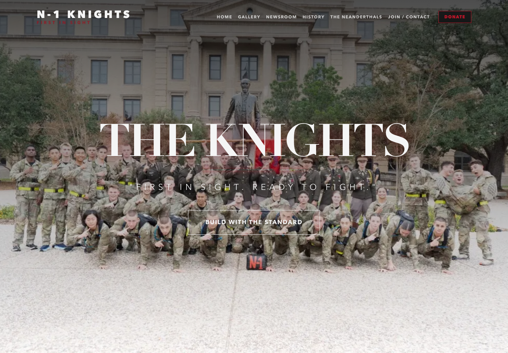

# Company N-1 Knights Website

I built and continue to manage the website for Company N-1, my outfit in the Texas A&M Corps of Cadets. The goal is to give cadets, prospective members, families, and alumni a clear place to find company information, follow updates, and stay connected to the outfit.

**Role:** Developer and maintainer  
**Website:** [n1-knights.com](https://n1-knights.com)  
**Source:** [d-guda/n1-knights-site](https://github.com/d-guda/n1-knights-site)

## Screenshots

Captured from the public website on October 21, 2026. Desktop and mobile home pages loaded successfully; no horizontal overflow was observed at the captured sizes. Form delivery was not tested in this review.

[View mobile home page](screenshots/mobile.png)

## Why I built it

The outfit needs a digital home that presents its identity and keeps useful information accessible beyond word of mouth. I built the site to support recruiting, preserve company history and photos, share cadet-written news, and make game-day information easier to find.

## My work

- Built the site's pages and shared components, including responsive navigation, page layouts, and the company's visual styling.
- Created a game-day information board with structured sections and a countdown that interprets event times in `America/Chicago`.
- Added gallery albums and an alumni photo archive with larger-image viewing.
- Built a newsroom that turns repository Markdown into article pages, alongside history, traditions, and recruiting/contact pages.
- Established Markdown and JSON content updates so routine changes can be reviewed through GitHub without changing page components.
- Continue to maintain content and improve the site's usability for the outfit.

## How it is built

| Layer | Implementation |
| --- | --- |
| Framework and UI | Next.js App Router, React, TypeScript |
| Styling and motion | Tailwind CSS, shared CSS, Framer Motion, Lucide icons |
| Content | Markdown files, custom parsing, JSON photo manifests, static images |
| Forms | Next.js server actions; code routes contact and email-list submissions to a configured Google Sheets webhook |
| Hosting workflow | Vercel deployment from the source repository's `main` branch |
| Analytics | Vercel Analytics integrated into the shared layout |

Visitors reach pages through Next.js. Server-side loaders read repository content and pass structured data to page and archive components. Form handlers validate input and send it to the configured destination; no form responses or integration secrets are included in this showcase.

## Maintenance example

A recorded maintenance change updated alumni navigation and the donation link across the shared navigation, page shell, and alumni content. See [the navigation maintenance commit](https://github.com/d-guda/n1-knights-site/commit/adbc251). This documents ongoing maintenance without claiming measured recruiting or traffic improvements.

## Value to the outfit

The site brings company identity, information, and archives together under one address. Its content structure also gives future maintainers a way to keep the site useful as cadets and leadership change.
